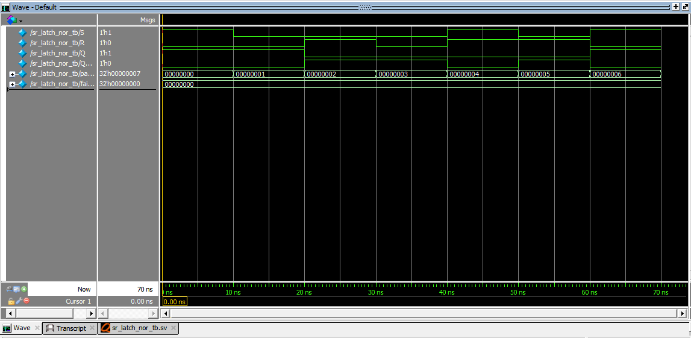

# SR Latch Using NOR Gates – SystemVerilog

## Overview

This project implements an active-HIGH SR (Set-Reset) latch using SystemVerilog.

An SR latch is a fundamental sequential logic circuit capable of storing one bit of information. It uses feedback to retain its previous state when both control inputs are LOW.

The design is functionally verified using a self-checking testbench in QuestaSim 10.7c.

## Design Specifications

| Signal | Direction | Width | Description |
|---|---|---:|---|
| `S` | Input | 1 bit | Set input |
| `R` | Input | 1 bit | Reset input |
| `Q` | Output | 1 bit | Main output |
| `Q_bar` | Output | 1 bit | Complementary output |

## SR Latch Truth Table

| S | R | Q (Next State) | Q_bar (Next State) | Operation |
|---:|---:|---:|---:|---|
| 0 | 0 | Previous Q | Previous Q_bar | Hold |
| 0 | 1 | 0 | 1 | Reset |
| 1 | 0 | 1 | 0 | Set |
| 1 | 1 | 0 | 0 | Invalid |

**Important:** For a NOR-based SR latch, `S = 1` and `R = 1` is the forbidden input condition. Both outputs become LOW, violating the complementary-output relationship.

## Working Principle

### 1. Set Condition

When `S = 1` and `R = 0`, the latch stores logic HIGH.

- `Q = 1`
- `Q_bar = 0`

### 2. Reset Condition

When `S = 0` and `R = 1`, the latch stores logic LOW.

- `Q = 0`
- `Q_bar = 1`

### 3. Hold Condition

When both inputs are LOW, the latch retains its previous state through feedback.

### 4. Invalid Condition

When both inputs are HIGH, both outputs become LOW. This is not a valid normal operating condition. The state following release of both inputs may be unpredictable in a physical latch.

## Project Structure

```text
01_sr_latch/
├── rtl/
│   └── sr_latch_nor.sv
├── testbench/
│   └── sr_latch_nor_tb.sv
├── simulation/
│   ├── waveform.png
│   └── simulation_output.txt
└── README.md
```

## Verification Methodology

A self-checking SystemVerilog testbench verifies the following seven directed scenarios:

1. Set
2. Hold after Set
3. Reset
4. Hold after Reset
5. Invalid condition
6. Recovery Reset
7. Recovery Set

The testbench checks the DUT outputs against expected values using case inequality (`!==`).

## Simulation Results

| Metric | Result |
|---|---:|
| Total test cases | 7 |
| Passed | 7 |
| Failed | 0 |
| Simulation status | PASS |

### Simulation Summary

```text
Total Tests : 7
PASS        : 7
FAIL        : 0
RESULT      : ALL TESTS PASSED
```

## Simulation Waveform



## Tools Used

- **HDL:** SystemVerilog
- **Simulator:** QuestaSim 10.7c
- **Editor:** Notepad
- **Verification:** Self-checking testbench

## Key Concepts Learned

- Sequential logic design
- SR latch operation
- Set, Reset and Hold conditions
- Cross-coupled NOR gate behavior
- Feedback and state retention
- Invalid input conditions
- SystemVerilog `always_latch`
- Functional verification using a testbench

## Author

**Preetkumar Kayasth**

GitHub: [preetkumarkayasth](https://github.com/preetkumarkayasth)