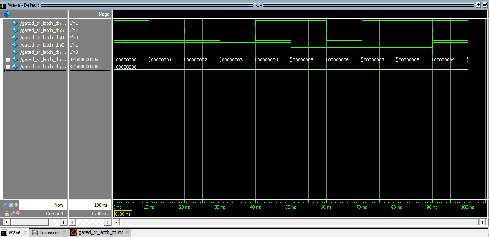

# Gated SR Latch – SystemVerilog

## Overview

This project implements a level-sensitive Gated SR (Set-Reset) Latch using SystemVerilog.

A Gated SR Latch is a sequential logic circuit that stores one bit of information. It uses an additional Enable input to control when the Set and Reset operations are allowed.

The design is functionally verified using a self-checking SystemVerilog testbench in QuestaSim 10.7c.

## Design Specifications

| Signal | Direction | Width | Description |
|---|---|---:|---|
| `EN` | Input | 1 bit | Enable control |
| `S` | Input | 1 bit | Set input |
| `R` | Input | 1 bit | Reset input |
| `Q` | Output | 1 bit | Main output |
| `Q_bar` | Output | 1 bit | Complementary output |

## Truth Table

| EN | S | R | Q (Next State) | Q_bar (Next State) | Operation |
|---:|---:|---:|---:|---:|---|
| 0 | X | X | Previous Q | Previous Q_bar | Hold |
| 1 | 0 | 0 | Previous Q | Previous Q_bar | Hold |
| 1 | 0 | 1 | 0 | 1 | Reset |
| 1 | 1 | 0 | 1 | 0 | Set |
| 1 | 1 | 1 | 0 | 0 | Invalid |

`X` represents a don't-care input. When Enable is LOW, changes in Set and Reset do not affect the stored state.

## Circuit Working Principle

The Gated SR Latch can be conceptually implemented using two AND gates and two cross-coupled NOR gates.

### 1. Enable Logic

The Set and Reset inputs are gated by the Enable signal:

- `S_g = EN & S`
- `R_g = EN & R`

### 2. Set Operation

When `EN = 1`, `S = 1` and `R = 0`:

- `Q = 1`
- `Q_bar = 0`

### 3. Reset Operation

When `EN = 1`, `S = 0` and `R = 1`:

- `Q = 0`
- `Q_bar = 1`

### 4. Hold Operation

When `EN = 0`, the latch retains its previous state irrespective of S and R.

When `EN = 1`, `S = 0` and `R = 0`, it also retains its previous state.

### 5. Invalid Condition

When `EN = 1`, `S = 1` and `R = 1`, both outputs become LOW. This is a forbidden operating condition.

The state after releasing the invalid inputs can be unpredictable in a physical latch.

## Project Structure

```text
02_gated_sr_latch/
├── rtl/
│   └── gated_sr_latch.sv
├── testbench/
│   └── gated_sr_latch_tb.sv
├── simulation/
│   ├── waveform.png
│   └── simulation_output.txt
└── README.md
```

## Verification Methodology

A self-checking SystemVerilog testbench verifies 10 directed test scenarios:

1. Set
2. Disabled Hold
3. Disabled Set
4. Disabled Reset
5. Enabled Hold
6. Reset
7. Disabled Set After Reset
8. Invalid Condition
9. Recovery Reset
10. Final Set

The testbench compares actual DUT outputs against expected values using case inequality (`!==`).

## Simulation Results

| Metric | Result |
|---|---:|
| Total test cases | 10 |
| Passed | 10 |
| Failed | 0 |
| Simulation status | PASS |

### Simulation Summary

```text
Total Tests : 10
PASS        : 10
FAIL        : 0
RESULT      : ALL TESTS PASSED
```

## Simulation Waveform



## Tools Used

- **HDL:** SystemVerilog
- **Simulator:** QuestaSim 10.7c
- **Editor:** Notepad
- **Verification:** Self-checking testbench

## Key Concepts Learned

- Sequential logic design
- Gated SR latch operation
- Enable-controlled storage
- Set, Reset and Hold conditions
- Cross-coupled NOR gate behavior
- Feedback and state retention
- SystemVerilog `always_latch`
- Functional verification

## Author

**Preetkumar Kayasth**

GitHub: [preetkumarkayasth](https://github.com/preetkumarkayasth)