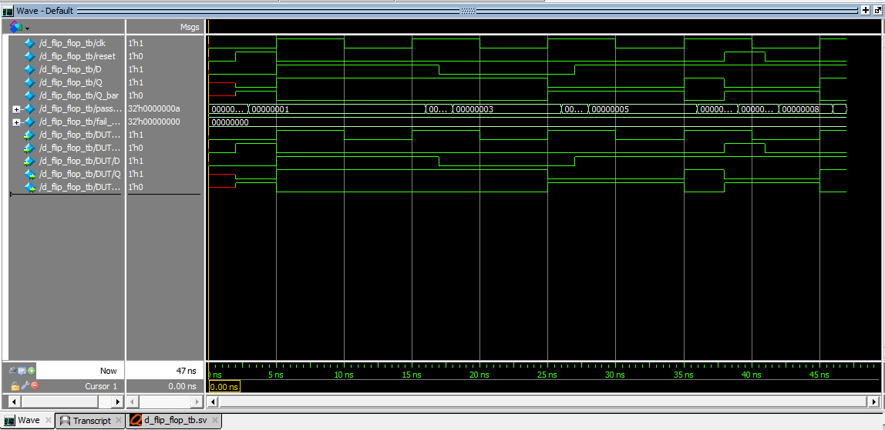

# Project 25: D Flip-Flop using SystemVerilog

## Overview

This project implements a positive-edge-triggered D Flip-Flop with an active-high asynchronous reset using SystemVerilog.

A D Flip-Flop is a fundamental sequential logic circuit that stores one bit of information. It captures the input data at the rising edge of the clock and retains the stored value until the next active clock edge or reset event.

The design was implemented and simulated using QuestaSim 10.7c.

## Design Specifications

| Parameter | Description |
|---|---|
| Circuit | D Flip-Flop |
| HDL | SystemVerilog |
| Clock triggering | Positive edge |
| Reset type | Asynchronous |
| Reset polarity | Active-high |
| Data input | D |
| Clock input | clk |
| Reset input | reset |
| Outputs | Q, Q_bar |
| Simulator | QuestaSim 10.7c |

## Functional Description

The D Flip-Flop captures the value of D at every positive edge of the clock.

- When reset is HIGH, Q is immediately cleared to 0.
- When reset is LOW and the clock has a rising edge, Q captures D.
- Between rising clock edges, Q retains its previous value.
- Q_bar is always the complement of Q.

### Characteristic Equation

At the active clock edge, when reset is inactive:

Q(next) = D

### Truth Table

| Reset | Clock Event | D | Q(next) | Q_bar |
|---|---|---|---|---|
| 1 | Any | X | 0 | 1 |
| 0 | Rising edge | 0 | 0 | 1 |
| 0 | Rising edge | 1 | 1 | 0 |
| 0 | No rising edge | X | Previous Q | Complement |

## Project Structure

```text
04_d_flip_flop/
│
├── rtl/
│   └── d_flip_flop.sv
│
├── testbench/
│   └── d_flip_flop_tb.sv
│
├── simulation/
│   ├── waveform.png
│   └── simulation_output.txt
│
└── README.md
```

## RTL Implementation

The design uses:

- `always_ff` for sequential logic.
- `posedge clk` for positive-edge triggering.
- `posedge reset` for asynchronous reset.
- Non-blocking assignment (`<=`) for sequential data storage.
- Continuous assignment for the complementary output.

## Verification Methodology

A self-checking SystemVerilog testbench was developed to verify the functional behaviour of the design.

The testbench covers:

1. Asynchronous reset.
2. Capturing logic 1.
3. Data retention when D changes between clock edges.
4. Capturing logic 0.
5. Retaining previously stored data.
6. Repeated data capture.
7. Reset assertion without a clock edge.
8. State retention after reset release.
9. Data capture after reset.
10. Complementary output verification.

The testbench uses case equality/inequality checks to detect incorrect and unknown output values.

## Simulation Results

| Metric | Result |
|---|---:|
| Total test cases | 10 |
| Passed | 10 |
| Failed | 0 |
| Simulation time | 47 ns |
| Overall status | PASS |

**Result: ALL TESTS PASSED**

## Simulation Waveform



The waveform demonstrates asynchronous reset behaviour, positive-edge data capture, and output retention between clock edges.

## Tools Used

- SystemVerilog
- QuestaSim 10.7c
- Windows environment

## Key Learning Outcomes

- Understanding the difference between a latch and a flip-flop.
- Implementing edge-triggered sequential logic.
- Understanding asynchronous reset behaviour.
- Using `always_ff` and non-blocking assignments.
- Writing self-checking SystemVerilog testbenches.
- Verifying sequential circuits through simulation and waveform analysis.

## Author

**Preetkumar Kayasth**

GitHub Repository: [Verilog Digital Design Basics](https://github.com/preetkumarkayasth/verilog-digital-design-basics)
